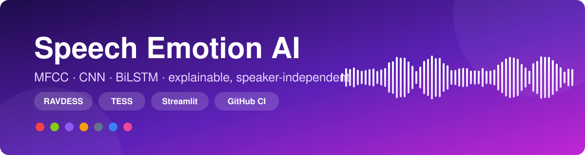
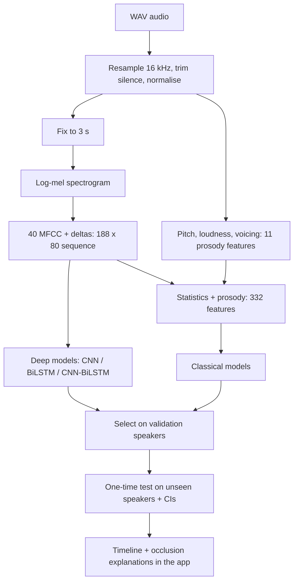
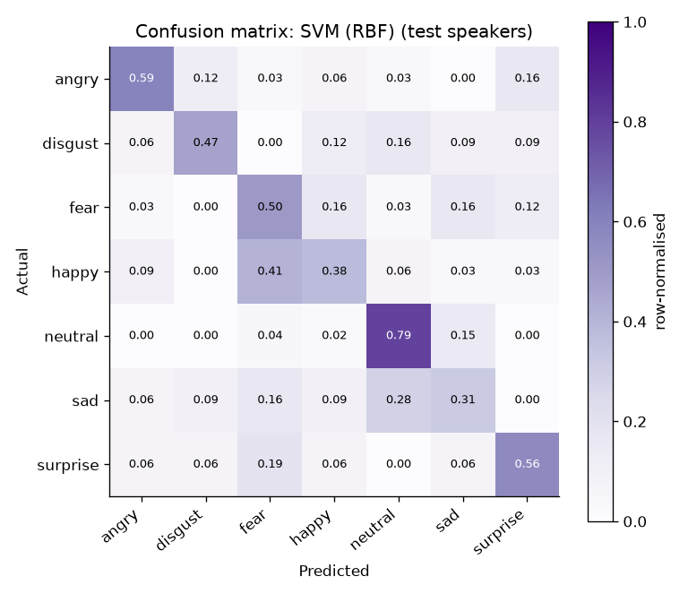
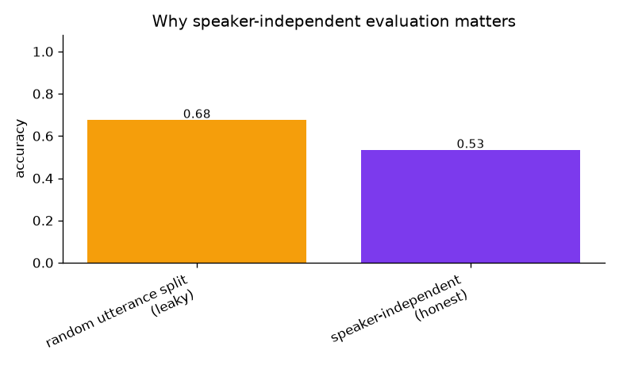
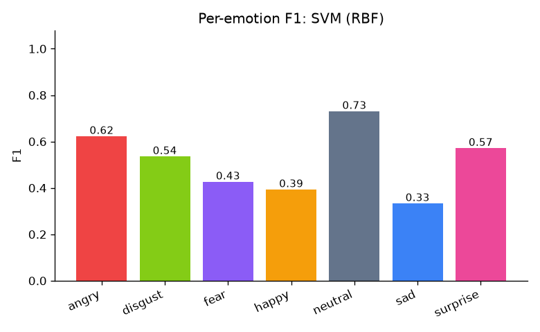
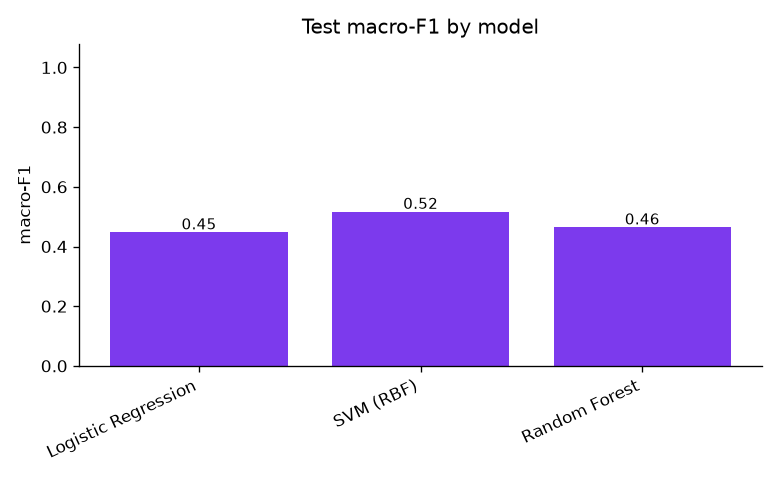
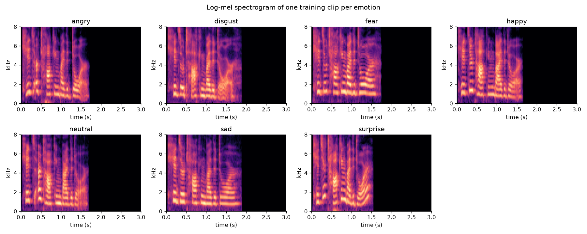
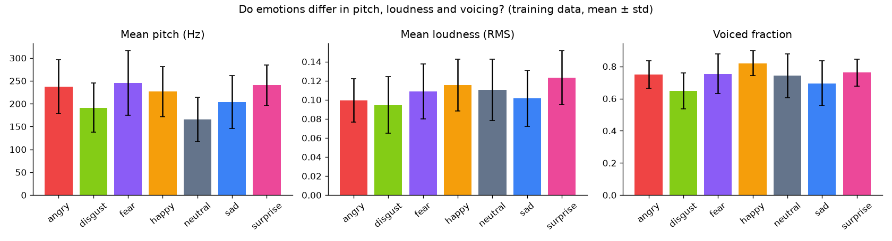

<div align="center">



<br/>

[](https://github.com/vanshitachoudhary/CodeAlpha_EmotionRecognition/actions)


*CodeAlpha Machine Learning Internship · Task 2: Emotion Recognition from Speech*

</div>

> **Ethics note:** this is an educational project built on acted emotions. It must not be used to evaluate people (hiring, students, employees), for surveillance, or for any mental-health decision.

## 📑 Contents
[Problem](#-problem) · [At a glance](#-at-a-glance) · [What makes it different](#-what-makes-it-different) · [The app](#-the-app) · [Methodology](#-methodology) · [Data and setup](#-data-and-setup) · [Training](#-training) · [Results](#-results) · [Design decisions](#-design-decisions) · [Deploy](#-deploy-the-live-demo) · [Structure](#-project-structure) · [Limitations](#-limitations-and-responsible-use) · [Roadmap](#-roadmap)

## 🎯 Problem
Recognise the emotion in a speech clip (angry, disgust, fear, happy, neutral, sad, surprise) and make the prediction **trustworthy and explainable**: how confident is the model, how does the emotion change during the clip, and which parts of the audio drove the decision?

## 📈 At a glance

| 7 | 2 | 332 | 4+ | 188×80 | 100% |
|:---:|:---:|:---:|:---:|:---:|:---:|
| emotions | corpora (RAVDESS, TESS) | features per clip | models compared | MFCC sequence for deep nets | speaker-independent test (RAVDESS) |

## 💡 What makes it different

Most speech-emotion demos load `librosa`, randomly split utterances and report one inflated accuracy. This project is built to be defensible:

| | |
|---|---|
| 🎚️ **Audio front-end written from scratch** | Mel filterbank, STFT, MFCC, delta features, autocorrelation F0 tracker and prosody statistics in plain NumPy/SciPy. Every piece is unit-tested (mel scale, filterbank coverage, delta of a ramp, F0 of pure tones) |
| 🧑‍🤝‍🧑 **Speaker-independent evaluation** | RAVDESS is split **by actor** (gender-balanced). Test actors are never seen in training or model selection |
| 🔍 **Leakage demonstrated, not just avoided** | `train.py` measures the same model with a leaky random utterance split and with the honest speaker split, and reports the gap |
| 🧠 **Classical and deep models** | Logistic Regression, SVM, Random Forest on MFCC statistics + prosody; 1D-CNN, BiLSTM and CNN-BiLSTM (Keras) on MFCC + delta sequences |
| 🔊 **Augmentation** | Noise at random SNR, time shift, speed change and gain on training clips only |
| 🌍 **Cross-corpus test** | Train on RAVDESS, test on TESS and back: the real measure of generalisation |
| 👥 **Subgroup analysis** | Performance by corpus and by speaker gender |
| 📐 **Uncertainty reported** | 95% bootstrap confidence intervals on accuracy and macro-F1 |
| 🕒 **Emotion over time** | Sliding-window predictions show how emotion changes inside a clip |
| 🧪 **Model-agnostic explanation** | Occlusion: silence each 0.5 s of the audio and measure how much the prediction drops |
| 📋 **Auto-generated reports** | `RESULTS.md` and `MODEL_CARD.md` are written from the actual run |
| 🧱 **Engineering** | Tests, GitHub Actions CI, Dockerfile, graceful fallback to a classical model if TensorFlow is unavailable |

## 🖥️ The app

| View | What it does |
|---|---|
| **Analyse speech** | Upload a WAV or record from the microphone. Get the emotion, confidence bars, a waveform + spectrogram with the **occlusion heat map**, pitch / loudness facts, the **emotion timeline** and a CSV download |
| **Batch** | Analyse many files, see the emotion distribution, download results |
| **Model performance** | Model comparison, leaky-vs-honest evaluation, subgroups, cross-corpus results, confusion matrix, per-emotion F1, spectrograms and prosody per emotion |
| **How it works** | The pipeline in five steps |
| **Model card** | Intended use, data, evaluation, limitations, ethics |

## 🔬 Methodology



## 📦 Data and setup

| Corpus | Content | Clips | Speakers |
|---|---|:---:|:---:|
| **RAVDESS** (speech) | acted North-American English sentences | 1,440 | 24 actors |
| **TESS** | acted words after "Say the word ..." | 2,800 | 2 actresses |

Label mapping: RAVDESS *calm* is merged into *neutral*; TESS *pleasant surprise* becomes *surprise*. Both corpora are acted, not spontaneous. Please respect each dataset's licence and cite the authors when you use them.

```bash
git clone https://github.com/vanshitachoudhary/CodeAlpha_EmotionRecognition.git
cd CodeAlpha_EmotionRecognition
pip install -r requirements.txt
pip install -r requirements-dl.txt      # optional: TensorFlow for CNN / BiLSTM

python download_data.py                 # RAVDESS downloads automatically; prints steps for TESS
```
Put the data under `data/` (any sub-folder layout works; files are found by name): `data/ravdess/Actor_01/...wav` and `data/tess/...wav`.

## 🏋️ Training

```bash
python train.py --data data                     # classical + CNN + BiLSTM + CNN-BiLSTM
python train.py --data data --fast              # quick run (1 deep model, 15 epochs)
python train.py --data data --models classical  # no TensorFlow needed
python train.py --data data --cross             # add the cross-corpus test
```
Training writes models to `models/`, plots and reports to `outputs/`. Then `streamlit run app.py`.

## 📊 Results

Everything below is generated by `train.py` from your run; open the files on GitHub for the exact numbers and confidence intervals:

- [`outputs/RESULTS.md`](outputs/RESULTS.md): model comparison, confidence intervals, per-emotion F1, subgroups, leaky-vs-honest and cross-corpus tables
- [`outputs/MODEL_CARD.md`](outputs/MODEL_CARD.md): intended use, data, limitations, ethics

<table>
  <tr>
    <td align="center"><br/><sub>Confusion matrix (unseen speakers)</sub></td>
    <td align="center"><br/><sub>Random split (leaky) vs speaker-independent (honest)</sub></td>
  </tr>
  <tr>
    <td align="center"><br/><sub>Per-emotion F1</sub></td>
    <td align="center"><br/><sub>Test macro-F1 by model</sub></td>
  </tr>
  <tr>
    <td align="center"><br/><sub>One spectrogram per emotion</sub></td>
    <td align="center"><br/><sub>Pitch, loudness and voicing per emotion</sub></td>
  </tr>
</table>

## 🧭 Design decisions

- **No `librosa`.** Writing the front-end myself removes a heavy dependency (numba) and makes every step testable and explainable.
- **No utterance-duration feature.** TESS clips are about 2 s and RAVDESS about 3.5 s, so duration would let a model identify the *corpus* instead of the emotion, and it breaks sliding-window inference.
- **Model selection on validation speakers, test once.** Test actors never influence any choice.
- **RAVDESS calm to neutral.** Common practice; it is documented in the model card.
- **TESS is reported but flagged.** With only two speakers a speaker-independent split is impossible, so TESS numbers are optimistic; cross-corpus testing is the honest check.
- **Graceful degradation.** If the best model is a Keras model but TensorFlow is missing (for example on a small host), the app falls back to the best classical model and says so.

## 🚀 Deploy the live demo

The app needs a **trained model**, and the datasets are not in the repository, so train locally and commit the results:

1. `python train.py --data data` (creates `models/` and `outputs/`).
2. Remove nothing from `.gitignore` for these two folders: **commit `models/` and `outputs/`** (`git add .`). If a file in `models/` is larger than 50 MB, delete it and its entry in `models/meta.json`.
3. Push to GitHub, then on [share.streamlit.io](https://share.streamlit.io) choose *Create app*, pick this repository, branch `main`, file `app.py`, and in *Advanced settings* choose **Python 3.11**.
4. Deep model on the cloud (optional): add `tensorflow-cpu>=2.15,<2.21` to `requirements.txt`. Without it the app serves the best classical model.

## 🗂️ Project structure

```
CodeAlpha_EmotionRecognition/
├── app.py                  # Streamlit app (5 views)
├── train.py                # features, models, evaluation, plots, reports
├── features.py             # from-scratch audio front-end (MFCC, F0, prosody)
├── augment.py              # waveform augmentation
├── data.py                 # RAVDESS / TESS parsing, speaker-independent splits
├── ml.py                   # classical models, metrics, bootstrap CIs
├── dl.py                   # Keras CNN / BiLSTM / CNN-BiLSTM
├── predictor.py            # inference, timeline, occlusion, fallback
├── ui.py                   # HTML/CSS components (tested)
├── download_data.py        # dataset helper
├── make_demo_data.py       # synthetic audio for pipeline tests only
├── tests/                  # unit + end-to-end tests
├── models/  outputs/       # generated by train.py (commit for the live demo)
├── .github/workflows/      # CI
└── Dockerfile
```

## ⚠️ Limitations and responsible use

- **Acted, studio-quality speech.** Real conversations, noisy rooms, other languages and accents will be much harder.
- **Few speakers** (24 + 2): speaker variety is limited, and the test split is small, so confidence intervals are wide.
- **Emotion categories are culturally constructed**; the output is a probability, not a fact about a person's inner state.
- **Pitch shifting augmentation is not implemented**; the augmentation set is noise, shift, speed and gain.
- The synthetic generator in `make_demo_data.py` exists only to test the pipeline; models trained on it mean nothing.

## 🛣️ Roadmap

- [ ] Pitch-shift and SpecAugment augmentation
- [ ] Pre-trained speech encoders (wav2vec 2.0) as a stronger baseline
- [ ] More corpora (CREMA-D, EMO-DB) and leave-one-corpus-out evaluation
- [ ] Probability calibration and temperature scaling

---

<div align="center">

**Vanshita Choudhary**

[GitHub](https://github.com/vanshitachoudhary) · [LinkedIn](https://www.linkedin.com/in/vanshita-choudhary-53840435b/)

*If you found this useful, a ⭐ on the repo is appreciated.*

</div>
